# CropAutomation

**Automatic IC² crop breeding for Enigmatica 2 Expert Extended**

Build a small farm, give it a starting crop, and tell it what you need. **CropAutomation** can breed a new crop species, work toward specific **Growth / Gain / Resistance** stats, and produce the requested number of seeds.

The **Station** manages orders. The **Robot** works on the field. Finished items are delivered to the **Output** chest.

<a href="media/ready_farm.png" title="View the completed farm full size">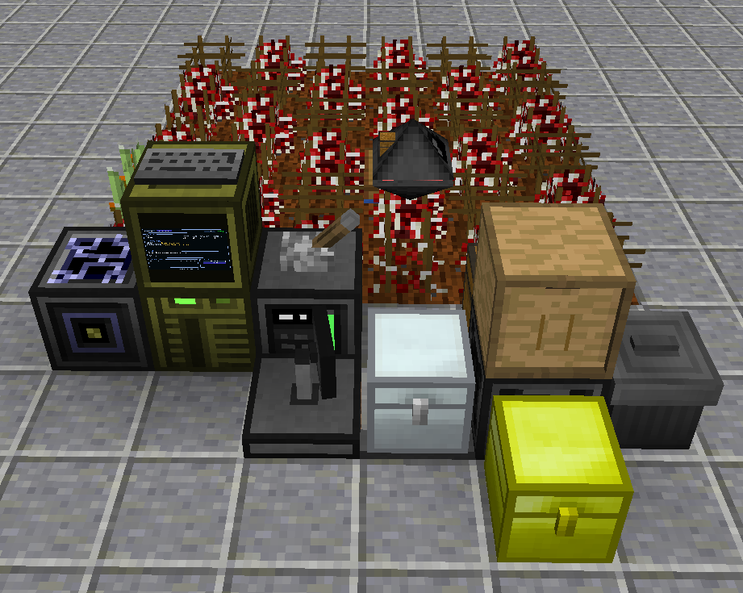</a>

**Jump to:** [What you're building](#what-youre-building) · [Equipment](#equipment) · [Build the farm](#build-the-farm) · [Install the software](#install-the-software) · [First startup](#first-startup) · [First order](#your-first-order) · [Troubleshooting](#troubleshooting)

---

## What you're building

CropAutomation uses **one 6×6 field**, a dock for the Robot, a Station computer, and a few connected inventories.

| Part | What it does |
|---|---|
| **Station** | Controls the farm, displays status, and manages up to 20 queued orders (one active at a time). |
| **Robot** | Plants, crosses, harvests, clears cells, and moves between the field and dock. |
| **Genebank** | Stores useful crop samples and can provide your starting seeds. |
| **Crop Sticks Drawer** | Supplies the Robot with Crop Sticks. |
| **Robot I/O** | Transfers items between the Robot and the Station's storage system. |
| **Output** | Receives seeds that match completed order requirements. |
| **Trash Can** | Discards unwanted items. |


## Equipment

The tables below are the build checklist. Expand only the section you need.

<details>
<summary><strong>Station, dock, and storage - full parts list</strong></summary>

| Item | Qty | Mod |
|---|---:|---|
| Computer Case (Tier 2) | 1 | OpenComputers |
| Screen (Tier 2) | 1 | OpenComputers |
| Keyboard | 1 | OpenComputers |
| EEPROM (Lua BIOS) | 1 | OpenComputers |
| Graphics Card (Tier 2) | 1 | OpenComputers |
| CPU (Tier 2) | 1 | OpenComputers |
| Memory (Tier 2) | 2 | OpenComputers |
| HDD (Tier 1) - Station disk | 1 | OpenComputers |
| Network Card | 1 | OpenComputers |
| Relay | 1 | OpenComputers |
| Wireless Network Card (Tier 1) - goes inside Relay | 1 | OpenComputers |
| Open Sensor | 1 | OC Sensors |
| Charger | 1 | OpenComputers |
| Transposer | 1 | OpenComputers |
| Power Converter | 1 | OpenComputers |
| Chest (27 slots) - Robot I/O | 1 | Minecraft |
| Iron Chest (54 slots) - Genebank | 1 | Iron Chests |
| Chest (any size) - Output | 1 | Minecraft / another mod |
| Trash Can | 1 | Extra Utilities 2 |
| Drawer - Crop Sticks | 1 | Storage Drawers |

</details>

<details>
<summary><strong>Robot - full parts list</strong></summary>

| Item | Qty | Mod |
|---|---:|---|
| Computer Case (Tier 2) | 1 | OpenComputers |
| Screen (Tier 1) | 1 | OpenComputers |
| Keyboard | 1 | OpenComputers |
| Wireless Network Card (Tier 1) | 1 | OpenComputers |
| APU (Tier 2) | 1 | OpenComputers |
| Inventory Upgrade | 1 | OpenComputers |
| Inventory Controller Upgrade | 1 | OpenComputers |
| Memory (Tier 2) | 1 | OpenComputers |
| EEPROM (Lua BIOS) | 1 | OpenComputers |
| HDD (Tier 1) - Robot disk | 1 | OpenComputers |
| Weeding Trowel | 1 | IndustrialCraft 2 |

</details>

<details>
<summary><strong>Farm supplies and assembly tools</strong></summary>

| Item | Qty | Mod |
|---|---:|---|
| OC Cable | 4 | OpenComputers |
| Lever | 1 | Minecraft |
| Crop Sticks | As many as possible; minimum 64 | IndustrialCraft 2 |
| Starting plant or seed | At least one | IC² Crops |
| Electronics Assembler | 1 | OpenComputers |

</details>

You will also need **power**, farmland, Dirt, and water. For the software installation, use an existing OpenOS computer with an **Internet Card**, or [set one up below](#prepare-an-installation-computer).

---

## Build the farm

### 1. Choose a location and prepare the field

For better IC² crop growing conditions, a humid biome such as **Swampland** or **Jungle** is recommended, with planting positions **above Y=128**. Humidity and altitude help, but some crops still have their own growing requirements.

1. Make a **6×6** area of farmland.
2. Under **each farmland block**, place **three layers of Dirt**.
3. Hydrate the farmland with water. The example uses a water source covered by a trapdoor.
4. Leave room **above the field** for the Robot to move.

<a href="media/farm_grid.png" title="View the field full size">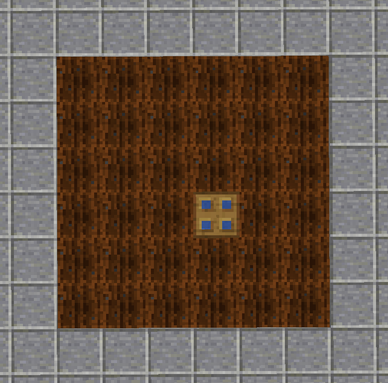</a>

<a href="media/farm_grid_bottom.png" title="View the dirt layers full size">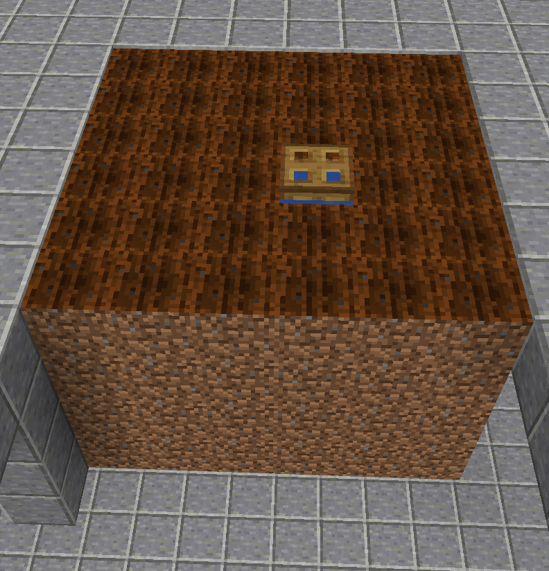</a>

> [!NOTE]
> Till the farmland yourself; CropAutomation does not do this. A water source or trapdoor takes up one field cell, which the software treats as an obstacle. You can choose where to put it.

### 2. Build the Robot dock

The dock is the Robot's charging and item-exchange area. **Stand outside the field and face it** when following the directions below; the field should be in front of you.

**First, build the front row:**

1. Place the **Charger** with a **Lever** on it. Turn the lever **on**.
2. Leave one empty block to the **right** of the Charger: this is the Robot's **HOME** position. Keep the space above HOME clear.
3. Place a regular **27-slot chest** immediately to the right of HOME: **Robot I/O**.
4. Place the **Open Sensor** immediately behind the Charger.
5. Place the **Transposer** immediately behind Robot I/O.

<a href="media/doc_part_1.png" title="View dock base full size">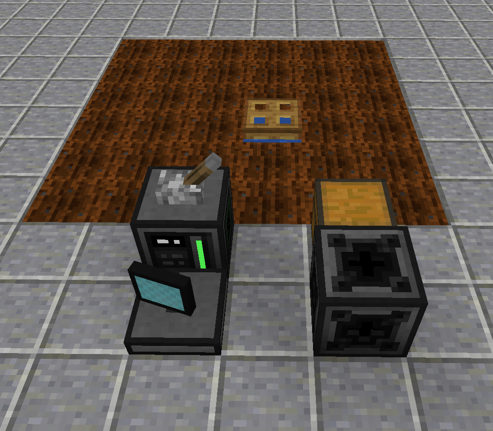</a>

**Now place the storage around the Transposer:**

1. **Genebank:** a **54-slot Iron Chest** to the **left** of the Transposer, behind HOME.
2. **Output:** any chest **behind** the Transposer, opposite Robot I/O.
3. **Trash Can:** directly to the **right** of the Transposer.
4. **Crop Sticks Drawer:** directly **on top** of the Transposer.

All five connected blocks - **Robot I/O, Genebank, Output, Trash Can, and Drawer** - must **touch the Transposer directly**.

<a href="media/doc_part_2.png" title="View storage layout full size">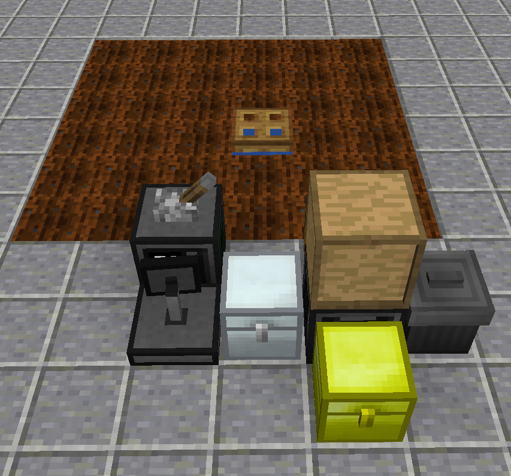</a>

**Finally, place Station and Relay:**

1. Put the **Station Computer Case (Tier 2)** to the **left** of the Charger.
2. Put the **Screen (Tier 2)** on the case and attach the **Keyboard** to the screen as shown.
3. Put the **Relay** immediately to the **left** of the Station case.

<a href="media/doc_part_3.png" title="View Station and Relay placement full size">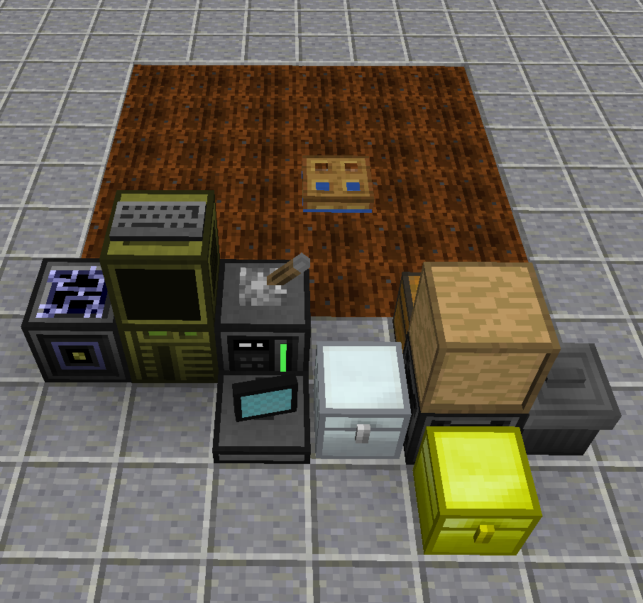</a>

> [!IMPORTANT]
> Relay must connect to the network **only through the adjacent Station case**. Do not let the keyboard, cables, or other devices touch Relay.

### 3. Connect the network and power

1. Run **OpenComputers Cables underneath the dock** to connect **Station, Charger, Open Sensor, and Transposer**.
2. Connect the **Open Sensor and Transposer from below** (not from the side).
3. Connect a **Power Converter** to this cable network and supply power from your energy system.

<a href="media/cable_power_connection_part_1.png" title="View OC cable layout full size">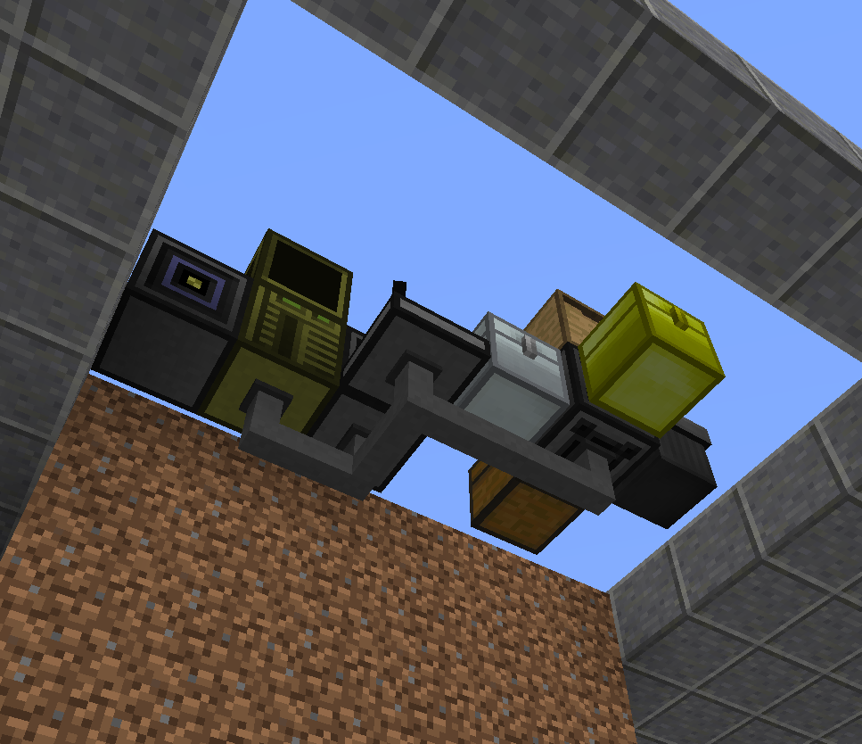</a>

<a href="media/cable_power_connection_part_2.png" title="View power connection full size">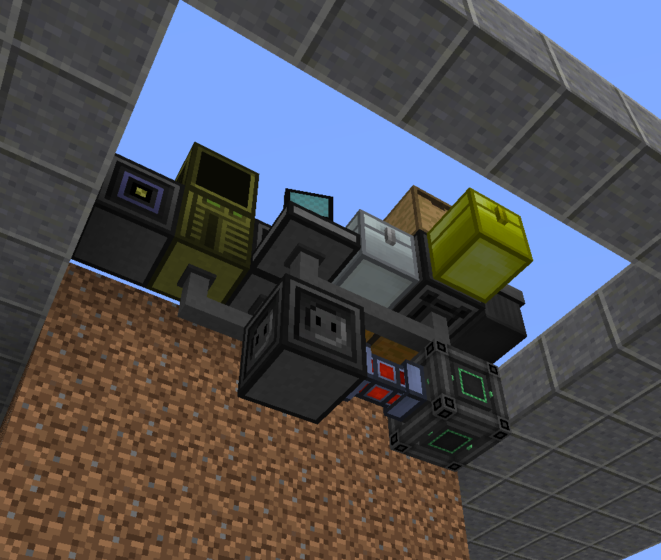</a>

Before moving on, put **as many Crop Sticks as possible** in the Drawer. The minimum stock is **64 sticks**; when the stock drops below 64, the system waits for more Crop Sticks to arrive. Keep the Drawer supplied while the system is running.

---

## Install the components

### Station

<details>
<summary><strong>Station, dock, and storage - full parts list</strong></summary>

| Item | Qty | Mod |
|---|---:|---|
| EEPROM (Lua BIOS) | 1 | OpenComputers |
| Graphics Card (Tier 2) | 1 | OpenComputers |
| CPU (Tier 2) | 1 | OpenComputers |
| Memory (Tier 2) | 2 | OpenComputers |
| HDD (Tier 1) | 1 | OpenComputers |
| Network Card | 1 | OpenComputers |

</details>

Insert the [Station components](#equipment) into the Station case, **but leave its HDD out** until the software is installed. Station uses a regular **Network Card**; the **Wireless Network Card** goes in Relay.

<a href="media/station_components.png" title="View Station components full size">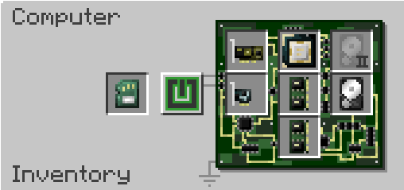</a>

### Robot

<details>
<summary><strong>Robot - full parts list</strong></summary>

| Item | Qty | Mod |
|---|---:|---|
| Computer Case (Tier 2) | 1 | OpenComputers |
| Screen (Tier 1) | 1 | OpenComputers |
| Keyboard | 1 | OpenComputers |
| Wireless Network Card (Tier 1) | 1 | OpenComputers |
| APU (Tier 2) | 1 | OpenComputers |
| Inventory Upgrade | 1 | OpenComputers |
| Inventory Controller Upgrade | 1 | OpenComputers |
| Memory (Tier 2) | 1 | OpenComputers |
| EEPROM (Lua BIOS) | 1 | OpenComputers |
| HDD (Tier 1) | 1 | OpenComputers |

</details>

Put the [Robot components](#equipment) into an **Electronics Assembler** as shown. **Do not assemble it yet**, and leave out the HDD: you must prepare that disk first.

<a href="media/robot_components.png" title="View Robot components full size">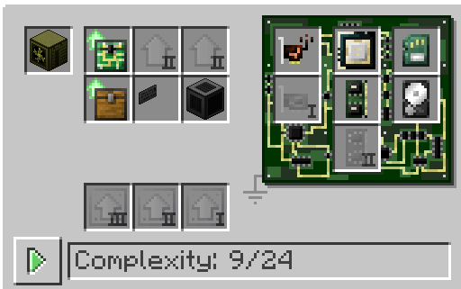</a>

### Relay

Insert the **Wireless Network Card (Tier 1)** into Relay.

<a href="media/relay_components.png" title="View Relay components full size">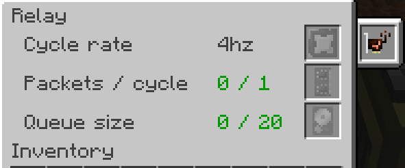</a>

---

## Install the software

You need **two separate HDDs**: one for **Station**, one for **Robot**. Prepare them on an OpenComputers computer running **OpenOS** and equipped with an **Internet Card**.

**Do not overwrite the installation computer's OpenOS system disk.** The installer lists suitable target HDDs separately; check the selected disk's address before confirming.

### Prepare an installation computer

If you already have an OpenOS computer with an Internet Card, skip to [Download the installer](#download-the-installer).

<details>
<summary><strong>How to set up an OpenOS installation computer</strong></summary>

<a href="media/assembly_station.png" title="View the OpenOS installation computer full size">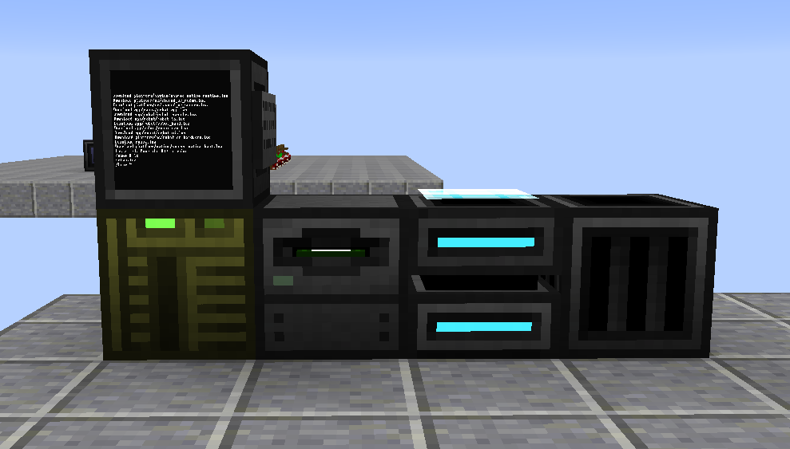</a>

An example setup:

| Item | Qty |
|---|---:|
| Computer Case (Tier 2) | 1 |
| Screen (Tier 1) and Keyboard | 1 each |
| CPU (Tier 1) and Graphics Card (Tier 1) | 1 each |
| Memory (any tier) | 1 |
| EEPROM (Lua BIOS) | 1 |
| Internet Card | 1 |
| HDD (Tier 1) | 1 |
| Disk Drive (block) | 1 |
| OpenOS (Operating System) floppy | 1 |

1. Assemble the computer with the HDD, EEPROM, CPU, RAM, graphics card, and Internet Card.
2. Attach its screen and keyboard. Place a Disk Drive nearby and insert the **OpenOS floppy**. Supply power.
3. Boot the computer and run:

   ```sh
   install
   ```

4. Follow the prompts to install OpenOS on **this computer's own HDD**.
5. Remove the floppy and restart. Use this computer to prepare the other two drives.

**Do not connect the Station or Robot HDDs while installing OpenOS.**

</details>

### Download the installer

Insert the **Station HDD** into your OpenOS installation computer. Run:

```sh
wget -f https://raw.githubusercontent.com/ForgTav/E2EE-CropAutomation/main/setup.lua
```

Then start the installer:

```sh
setup
```

### Install the Station HDD

1. In the installer, select **`1 - Station`**.
2. Choose the target disk by **number**, after checking its **address and label**.
3. At `Program files on the selected disk will be overwritten. Continue? [y/N]`, enter **`y`**.
4. When you see `Installed. Move the HDD to station.`, power off Station and insert the prepared HDD into its case.

<a href="media/setup_example.png" title="View installer example full size">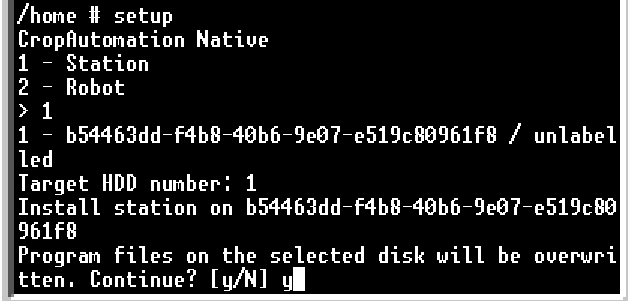</a>

### Install the Robot HDD

1. Insert the **second HDD** into the installation computer.
2. Run **`setup`** again.
3. Select **`2 - Robot`**.
4. Verify the target HDD's address, select it, and confirm with **`y`**.
5. Wait for `Installed. Move the HDD to robot.`
6. Put this HDD in the **Electronics Assembler** and finish assembling Robot.

> [!TIP]
> If installation fails, fix the reported problem and rerun the installer on the **same HDD for the same role**. Do not use a Station HDD as the Robot HDD, or vice versa.

---

## First startup

### 1. Start Robot

1. Place Robot at **HOME**, between Charger and Robot I/O.
2. Open its inventory and put the **Weeding Trowel in slot 16** (bottom-right slot of the main inventory).
3. Check power and make sure the **Charger lever is on**.
4. Turn on Robot. CropAutomation should start automatically.
5. Look for **Pairing code** and a **four-digit code** on its screen.

<a href="media/robot_home.png" title="View Robot at HOME full size">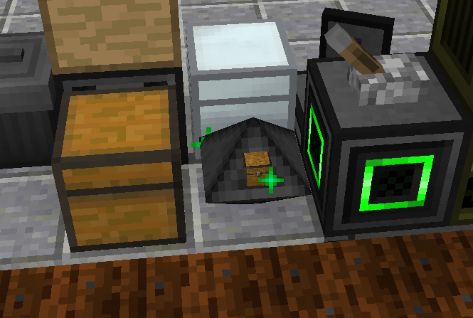</a>

<a href="media/robot_inventory.png" title="View Robot inventory full size">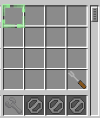</a>

<a href="media/pair_robot.png" title="View Robot pairing code full size">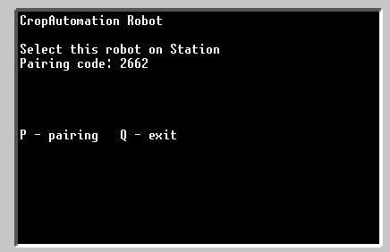</a>

### 2. Start Station and pair the devices

1. Turn on Station. It should start CropAutomation and open **System**.
2. Check that automation is **Stopped**. **Do not press START yet.**
3. Check that **Sensor, Genebank, Output, and Trash** are detected.
4. Click **LINK ROBOT**.
5. Select the Robot whose four-digit code matches the code on Robot's screen.
6. Press **REVIEW**, then **CONFIRM**.

<a href="media/pair_station.png" title="View Station pairing full size">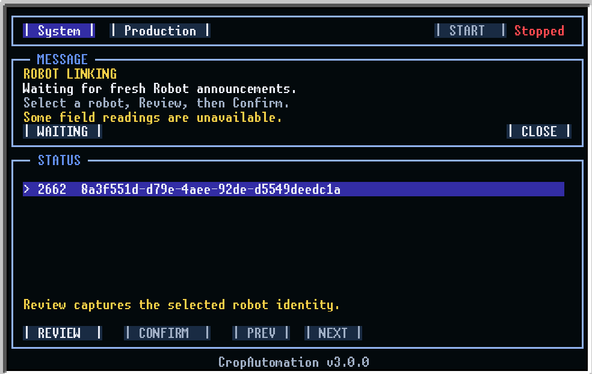</a>

Pairing is saved; you normally do not need to repeat it after a restart. Pairing must be done while automation is **Stopped**.

### 3. Add a starting crop

Choose **one** of these methods:

- Plant a starting crop in a suitable cell of the **6×6 field**.
- Put a starting seed or **IC² Seed Bag** in **Genebank**.

For your first test, use a crop you already have, such as **Reed** (from Sugar Cane) or **Wheat** (from Wheat Seeds). **Do not put starting material in Output.**

---

## Your first order

A simple first test: **produce 2 Reed seeds with any stats**. This confirms that pairing, the field, inventories, and item delivery work before trying harder breeding goals.

### 1. Start automation

Check that Robot is charged, the field is clear, and the Drawer has Crop Sticks. Press **START** on Station. The system surveys the field and prepares the inventories; without an order, its status becomes **Ready**.

Safe starting crops remain in the field until needed for an order. START does not collect them solely for Genebank.

If something is wrong, open **System** for guidance.

### 2. Create an order

1. Open **Production → New Order**.
2. Select **Reed** (use **PREV / NEXT** to browse crop pages).
3. Set **QUANTITY** to **`2`**.
4. Leave **Growth / Gain / Resistance** empty. Empty means **Any**.
5. Review **TERRAIN** for known growing conditions. A **`?`** means data is not yet available.
6. Press **CREATE**. If **TERRAIN WARNING** appears, review it; use **BACK** to edit or **CREATE ANYWAY** to proceed.

<a href="media/new_order.png" title="View new order screen full size">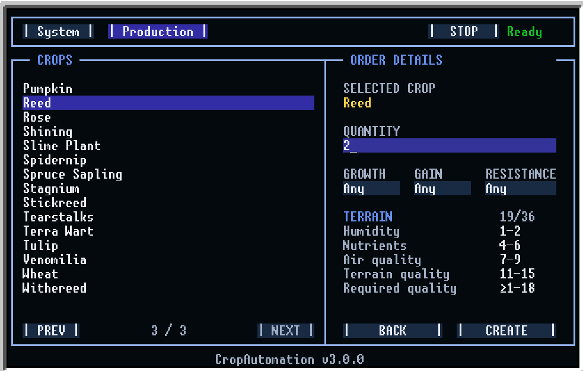</a>

### 3. Follow the order and collect your seeds

<a href="media/productuion_running.png" title="View the Production screen full size">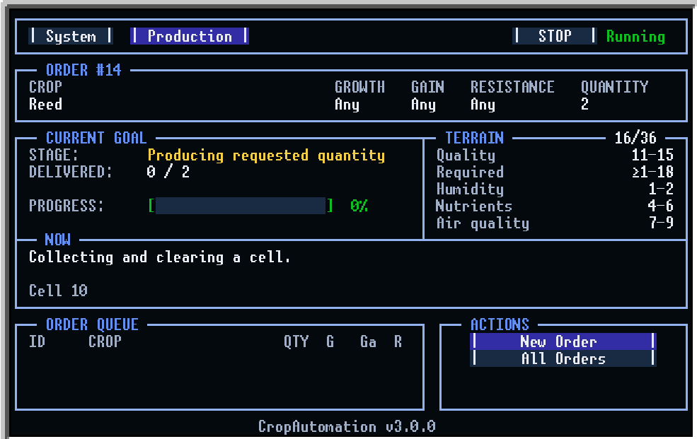</a>

Open **Production** to see the active goal and what Robot is doing or waiting for. **All Orders** displays the queue.

Finished items go into **Output**; the **DELIVERED** counter increases when they are transferred there. Removing items from Output does not reduce the counter.

> [!WARNING]
> **Keep Output empty enough to accept new items.** Empty it manually or use automatic item extraction. If Output fills up, production waits for free space.

### Want specific stats?

Each non-empty stat field requests an **exact value**. Blank means *no restriction*, which is not the same as zero.

| Field | Example | Result |
|---|---|---|
| Growth | `12` | Exactly Growth 12 |
| Gain | *(blank)* | Any Gain |
| Resistance | `0` | Exactly Resistance 0 |
| QUANTITY | `5` | Deliver 5 matching items |

**Gain** and **Resistance** accept `0–31`. Leave QUANTITY blank to request one item.

**Safe Growth limit:** do not request Growth `24+` (or `8+` for **Venomilia**). CropAutomation removes plants it considers dangerous at those values, so the highest safe requests are **23** and **7**, respectively.

Some low-stat vanilla crops produce ordinary seeds or planting items rather than an IC² Seed Bag; delivery uses the actual item type.

---

## Daily use

**Where to look:** **Production** shows the active work; **System** shows equipment, connection state, and guidance; **All Orders** is for queue management.

| Status | What it means |
|---|---|
| **Stopped** | Automation is not accepting new work. |
| **Ready** | Automation is enabled, with no active work. |
| **Running** | An order, preparation, growth, or crossbreeding is in progress. |
| **Waiting** | The system is waiting for a condition; this is **not always an error**. |

<a href="media/system_waiting.png" title="View System status full size">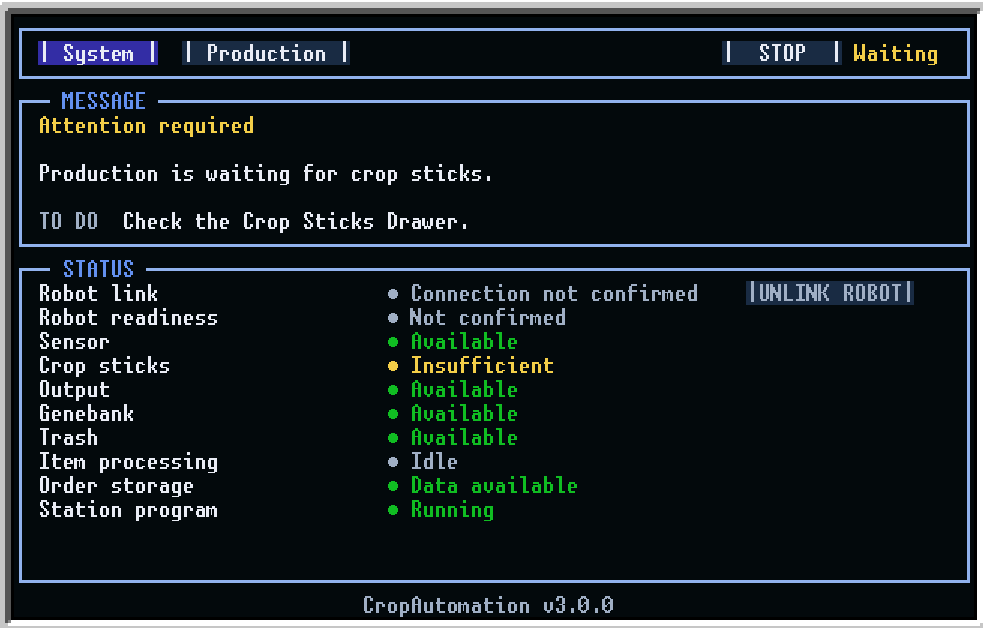</a>

**STOP / START:** STOP prevents new work; START resumes. Robot may still finish an already accepted operation after STOP. Let that action finish before moving any blocks or items.

**Edit / cancel:** In **All Orders**, select an order to **EDIT** its requirements and **SAVE**, or use its cancel button. Editing an active order may offer to retain or reset its delivered counter; items already in Output remain there. Cancel does not instantly stop an operation Robot already accepted.

<details>
<summary><strong>Inventory roles and reserved slots</strong></summary>

| Inventory | What it is for |
|---|---|
| **Drawer** | Keep as many Crop Sticks as possible; below the minimum stock of 64, the system waits for more. |
| **Genebank** | Saved crop samples and starting seeds. |
| **Robot I/O** | Automatic item exchange; do not rearrange while running. |
| **Output** | Finished items; keep space available. |
| **Trash Can** | Unwanted items. |

| Inventory | Slots | Reserved use |
|---|---|---|
| Robot | **1–13** | Cargo |
| Robot | **14** | Do not assign tools |
| Robot | **15** | Crop Sticks |
| Robot | **16** | Weeding Trowel |
| Robot I/O | **1** | Crop Sticks |
| Robot I/O | **2–22** | Ordinary items |
| Robot I/O | **23–26** | Used seed bag remnants |
| Robot I/O | **27** | Item reserved for planting |

The Robot manages its working slots automatically.

</details>

<details>
<summary><strong>Crop restrictions</strong></summary>

- **Weed** plants are removed.
- **Redwheat** is not used.
- **Cocoa**, **Red Mushroom**, and **Brown Mushroom** can be stored as archive crops only.
- The dangerous Growth thresholds are explained under [specific stats](#want-specific-stats).

</details>

---

## Troubleshooting

<details>
<summary><strong>Screen stays off after turning on the computer</strong></summary>

> The screen responds to redstone signals. Try switching the lever on and then off to turn the screen back on.

</details>

<details>
<summary><strong>Station cannot find or pair Robot</strong></summary>

> Check that Robot is on and running CropAutomation. Verify **Wireless Network Cards** in both Robot and Relay and sufficient power. Relay must touch **only Station**.

> If Robot is still paired to an old Station, stop automation and press **P**, then **Y**, on Robot to clear its pairing. Pair again using the new four-digit code.

</details>

<details>
<summary><strong>Station cannot detect Sensor, Transposer, or storage</strong></summary>

> Check power and cable connections. **Open Sensor and Transposer must connect from below.** Each storage block must touch Transposer directly. **Robot I/O must have 27 slots; Genebank must have 54.** The Station network should contain one Sensor and one Transposer.

</details>

<details>
<summary><strong>Robot is standing still / status says Waiting</strong></summary>

> Check **Production** first: waiting for plants to grow or crossbreed is normal. If **System** or Robot shows a problem, follow that message. Otherwise check **START**, charge, Charger lever, Crop Sticks in Drawer, and clearance above the field and dock. Waiting does not always produce a separate error message.

</details>

<details>
<summary><strong>Why does GENETICS say “Waiting for plants to mature” when a cell still needs double Crop Sticks?</strong></summary>

> Robot places double Crop Sticks for crossbreeding when at least two plants of the requested crop are ready and directly beside the spot. Diagonal neighbors do not count. Most crops can crossbreed from **growth stage 3**. Robot can do other eligible work while those parents grow.
> A useful plant can be moved to a suitable parent spot from **growth stage 2**.

</details>

<details>
<summary><strong>Plants are not growing, or breeding takes too long</strong></summary>

> Check the crop's light, soil, hydration, and other growing requirements. The suggested humid biome, high-altitude location, and three Dirt layers help but cannot guarantee every crop will grow. Crossbreeding has no fixed completion time.

</details>

<details>
<summary><strong>Output is full</strong></summary>

> Remove items from Output or configure item extraction. Production should resume when there is free space.

</details>

<details>
<summary><strong>Why did Robot remove a plant?</strong></summary>

> Robot clears cells to carry out orders and removes dangerous plants, including weeds and crops over the safe Growth thresholds. Do not leave a valuable plant in the working field if you need it preserved regardless of orders.

</details>

<details>
<summary><strong>What should I do after a power outage?</strong></summary>

 1. Inspect the field, Robot's position, its held item, and inventories. Avoid repeating an action whose outcome is unclear.
 2. Restore power and start **Robot** and **Station**.
 3. Station starts **Stopped**. Check **System** and Robot for warnings, resolve them, then press **START**.

> If **ORDER STORAGE WARNING** appears, the order file has been recreated and the old queue is unavailable.

</details>

